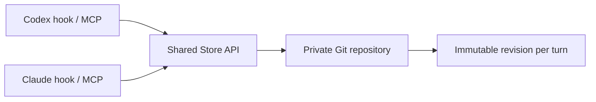

# PersonalMemoryOS

**Learn from user corrections. Carry scoped preferences across sessions. Keep every change in Git.**

[中文说明](README.zh-CN.md) · [Harness setup](docs/integrations.md) · [Design and examples](docs/design.md) · [Evidence](docs/evidence.md)

PersonalMemoryOS is a small, local-first preference memory for AI agents. Codex and Claude Code can share the same private memory repository through a CLI or three MCP tools. Each user turn reads an immutable Git snapshot; user corrections become small scoped updates, and undo preserves enough history to prevent old retries from resurrecting reverted rules.

**Status: 0.1 alpha.** The storage, concurrency, rollback, CLI, and hook behavior have automated tests. The natural-language interpretation is performed by your agent, guided by the included skill and hook instructions. This project does **not** claim measured improvements in model compliance, a complete semantic conflict solver, or hosted ChatGPT support. Public research supporting the approach is documented separately from this implementation's results.

## What it does

- Persists Markdown rules with stable IDs, scope, project, provenance, and timestamps.
- Loads global defaults plus selected scenarios and project rules from one commit.
- Automatically merges stale edits to independent rules; rejects overlapping stale edits.
- Serializes writers across local processes. All harnesses use the same store.
- Deduplicates feedback retries, including retries after a rollback.
- Undoes an individual feedback update without erasing unrelated updates or event history.
- Provides per-turn Codex/Claude Code hook output and an optional local stdio MCP server.

The core uses Python's standard library and Git. No vector database, model API key, or background daemon is required. The optional MCP transport uses the official Python MCP SDK. Supported platforms: macOS and Linux; Python 3.11+ and Git are required.

## Quick start

```bash
git clone https://github.com/tongmd/personalmemoryos.git
cd personalmemoryos
python3 -m venv .venv
.venv/bin/pip install -e '.[mcp]'
.venv/bin/pmos init
.venv/bin/python examples/demo.py
```

`pmos init` creates a **separate, private** Git repository at `~/.personalmemoryos`. It never creates a remote or uploads your preferences. The public source repository contains code and synthetic examples only. Set `PMOS_STORE` or pass `--store PATH` to use a different dedicated directory.

Try one scoped correction:

```bash
PMOS_REVISION=$(.venv/bin/pmos revision | python3 -c 'import json,sys; print(json.load(sys.stdin)["revision"])')
.venv/bin/pmos apply \
  --id answer.evidence --scope research \
  --text 'Support research conclusions with primary sources and relevant data.' \
  --source demo/turn-1/evidence \
  --evidence 'For research evaluations, show me examples and data.' \
  --base "$PMOS_REVISION"

.venv/bin/pmos recall --scope research
.venv/bin/pmos recall --scope coding
```

The research rule appears only in the research snapshot. A new process or session sees the same persisted state. A coding snapshot does not include the research rule.

Undo it:

```bash
PMOS_REVISION=$(.venv/bin/pmos revision | python3 -c 'import json,sys; print(json.load(sys.stdin)["revision"])')
.venv/bin/pmos revert demo/turn-1/evidence \
  --request-id demo/undo-1 --base "$PMOS_REVISION"
.venv/bin/pmos history
```

Retrying the original feedback ID after this undo returns `already_processed`; it cannot put the old rule back. To intentionally teach it again, use a new feedback ID.

## Everyday use

After [connecting a harness](docs/integrations.md), speak naturally:

| What you say | Expected agent behavior |
|---|---|
| “For future research evaluations, include primary sources and data.” | Update the research rule through `memory_apply`. |
| “This time, explain it in detail.” | Follow the current task without changing the lasting default. |
| “You forgot the evidence again.” | Check whether the existing rule was loaded and followed; avoid duplicate rules. |
| “Show my research preferences.” | Read the current research snapshot. |
| “Undo that memory update.” | Revert the identified feedback event, then refresh memory. |

The hook supplies the recall snapshot and feedback-learning instructions. The MCP server supplies the write tools. Install both for the intended automatic workflow; a hook alone cannot persist a correction. The host model still decides how to interpret and act on feedback. Use explicit CLI/tool calls when testing the backend independently.

## One entry, scoped files

An initialized store grows only as you teach it:

```text
~/.personalmemoryos/
├── .git/
├── store.json
├── MEMORY.md                      # Generated navigation
├── rules/
│   ├── global/answer.language.md
│   ├── research/answer.evidence.md
│   └── projects/alpha/coding/tests.runner.md
└── events/                        # Append-only feedback/undo receipts
```

One file per scoped rule makes provenance and targeted undo straightforward. Scenario directories keep related rules together. A single short `MEMORY.md` is the discovery entry point; it is not a second copy of every rule. Other file layouts can be added without changing the public operation model. The file count itself does not establish better compliance.

Each rule is plain Markdown with JSON frontmatter (also valid YAML):

```markdown
---
{"id":"answer.evidence","scope":"research","project":null,"source_id":"session/turn/rule","evidence":"Show me examples and data.","updated_at":"2026-11-03T00:00:00+00:00"}
---
Support research conclusions with primary sources and relevant data.
```

## Shared state and hot updates



Each recall captures `HEAD` once and reads files from that commit, never from a half-written working directory. Other harnesses see committed changes on their next turn. Each patch includes its base revision; independent changes can merge, while a changed target rule causes a conflict. A local file lock serializes writers. Do not run multiple writable clones and expect this process lock to coordinate them over a network.

Memory content updates do not rewrite `AGENTS.md`, `CLAUDE.md`, or skill files. Those contain static adapters. Changes to hook configuration, code, or tool schemas can require a host-specific reload or restart. See [the full consistency contract](docs/design.md).

## Verification and boundaries

```bash
.venv/bin/pip install -e '.[dev,mcp]'
.venv/bin/ruff check .
.venv/bin/python -m unittest discover -s tests -v
.venv/bin/python examples/demo.py
```

Tests cover scope isolation, new-client persistence, concurrent processes, stale-write conflicts, immutable reads, hook refresh, and rollback/retry behavior. They do not prove that a particular model follows every preference. [The behavioral evaluation protocol](docs/evaluation.md) compares no memory, frozen memory, and feedback-updated memory in fresh sessions.

The first version intentionally uses explicit scopes and a small configurable keyword router for hooks. It does not infer arbitrary semantic contradictions across differently named rules, automatically run behavioral A/B evaluations, or enforce arbitrary tool policies. Remote multi-device coordination, authenticated HTTP MCP, hosted ChatGPT packaging, and Windows locking are future work.

Memory Git history contains prior preference text and feedback evidence. Forgetting or undo changes active rules, not historical retention. Keep the store private and retain only the brief evidence you intend to preserve.

## License

MIT. Contributions should preserve the storage invariants and distinguish measured implementation behavior from intended model behavior.
